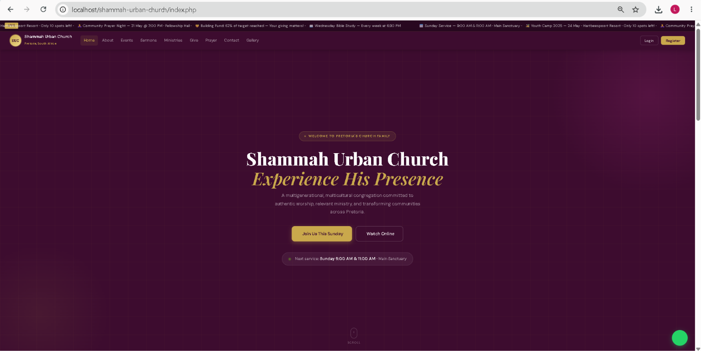
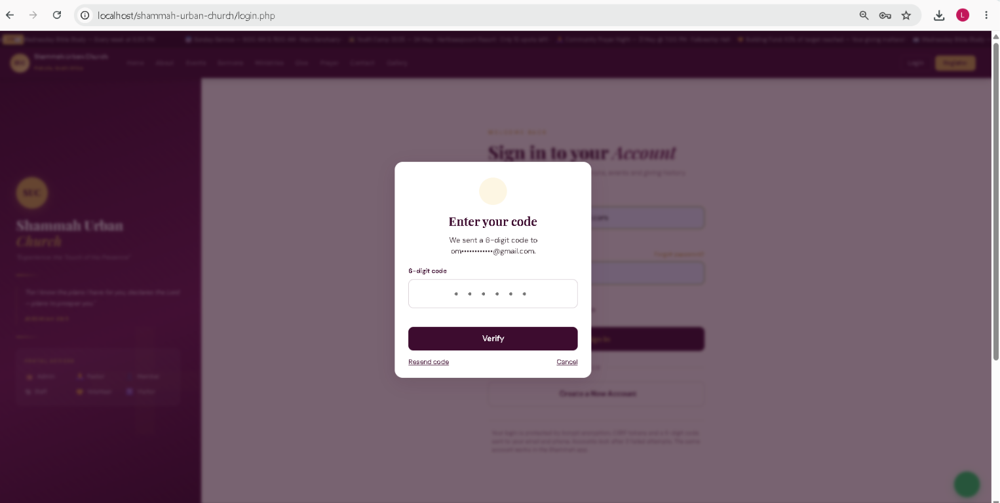
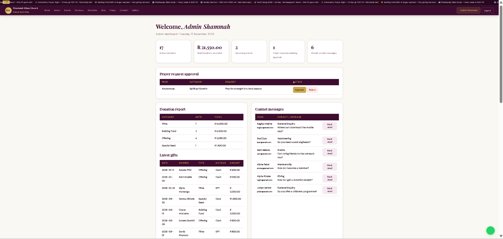
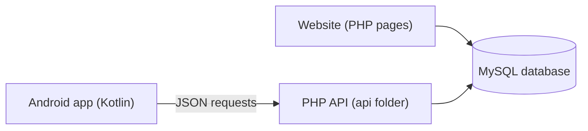

# Shammah Urban Church Website


The website, database and API for **Shammah Urban Church** in Pretoria. A member registers once and can then sign in on the website and on the Android app with the same email and password.

**Module:** XISD6329, Task 3 (final submission), Rosebank College (IIE)
**Team (CodeVision):** Omphile Moale (ST10455873), Oladele Rakgolela (ST10449832), Lebo Ramoshaba (ST10453111)

| | Link |
|---|---|
| Website repository (GitHub) | https://github.com/OmphileMoale/shammah-urban-church |
| Website repository (Azure DevOps) | https://dev.azure.com/ST10455873/XISD6329-Shammah-Urban-Church-CMES/_git/shammah-website |
| Android app repository | https://github.com/OmphileMoale/shammah-android-app |
| Demo video with voice-over | https://youtu.be/pcXUWuJYSbM |

## Contents

1. [Purpose](#1-purpose)
2. [Screenshots](#2-screenshots)
3. [Features](#3-features)
4. [Design considerations](#4-design-considerations)
5. [Technology](#5-technology)
6. [How to run it](#6-how-to-run-it)
7. [API for the Android app](#7-api-for-the-android-app)
8. [Database](#8-database)
9. [GitHub, GitHub Actions and Azure DevOps](#9-github-github-actions-and-azure-devops)
10. [Release notes](#10-release-notes)
11. [Team contributions](#11-team-contributions)
12. [Known limitations](#12-known-limitations)
13. [Use of AI tools](#13-use-of-ai-tools)
14. [Credits](#14-credits)

## 1. Purpose

Shammah Urban Church wanted one place where members can stay connected, and where the church leaders can look after members without paperwork. Members can see events and RSVP, read and listen to sermons, send prayer requests, join ministries and view their giving. Pastors and admins can manage members, approve prayer requests and see donations.

The system has three parts that share one database:

1. **The website**, written in PHP, for members and the public.
2. **The API**, in the `api` folder, which the Android app talks to.
3. **The Android app**, written in Kotlin, in its own repository.

Because the website and the app use the same database, a person who registers on the website can sign in on the phone straight away.

## 2. Screenshots







## 3. Features

**For everyone**
- Home, About, Events, Sermons, Ministries, Give, Prayer Wall, Gallery, Contact, Privacy and Terms pages.
- A different Bible verse every day.

**For members**
- Register and sign in with an email address and a password.
- A 6-digit code is emailed after the password, and the member types it in to finish.
- RSVP for events. The page shows how many spots are left.
- Join and leave ministries.
- Watch and listen to sermons, and write sermon notes that save in the browser.
- Send prayer requests.
- A member portal with profile, RSVPs, donations, volunteering and password change.

**For pastors and admins**
- A dashboard with key figures, the member list (activate or deactivate), a donation report, prayer request approval and contact messages.

**Security**
- Passwords are stored as bcrypt hashes, never as plain text.
- Three wrong passwords lock the account for 15 minutes.
- There are three roles: admin, pastor and member. The role is checked on the server for every request.
- Forms use CSRF tokens, every database query uses prepared statements, and output is escaped.

## 4. Design considerations

**One database for everything.** The website and the app read and write the same tables, so there is nothing to keep in sync. A member's role, sign-in codes and lockout all live in the database.

**Verify before saving.** When someone registers, their details wait in a temporary table. The member is only created after they type the correct 6-digit code. A mistyped or fake email never becomes an account, and unused details are deleted automatically.

**Real numbers.** Member counts, ministry counts, event RSVPs and spots remaining are read from the database. Nothing that changes is typed into a page. If MySQL is down, public pages still open with safe default values.

**Clear messages.** A wrong code says how many tries are left. A fake email domain is rejected with an explanation. A full event says it is fully booked.

**Checks on the server.** The browser or app checks input first, and the server checks it again, because anyone can bypass the first check.

**Secrets stay out of the repository.** The email password is kept in an Apache setting or in a file listed in `.gitignore`. Logs are also ignored.

**Demo accounts for markers.** The three demo accounts have no real inbox, so their code is shown on screen. Every other account receives its code by email. One setting, `DEMO_MODE` in `includes/notify_config.php`, turns this off.

**Logging.** Problems are written to the PHP error log with a clear prefix, for example `Shammah ministry_join failed`, so they are easy to find.

How the parts fit together:



Sign-in steps:

1. The member enters an email address (or phone number) and a password.
2. The server checks the password and the lockout, then emails a 6-digit code.
3. The member enters the code. For a new registration, this is when the account is created.
4. The website starts a session, or the app receives a token.

## 5. Technology

| Part | Technology |
|---|---|
| Website | PHP, HTML, CSS and JavaScript |
| Database | MySQL |
| Local server | XAMPP (Apache and MySQL) |
| Android app | Kotlin (separate repository) |
| Source control | Git, GitHub and Azure Repos |
| Automation | GitHub Actions and Azure Pipelines |

The automated test scripts in the `tests` folder are written in Python. They are used only by the pipelines, and they are not needed to run the website.

## 6. How to run it

1. Copy this folder to `C:\xampp\htdocs\shammah-urban-church`.
2. Start **Apache** and **MySQL** in the XAMPP Control Panel.
3. Look at the MySQL port in the Control Panel. The default is 3306, and ours is 3307. Set `DB_PORT` in `includes/db.php` to match.
4. Import the two SQL files into MySQL, with phpMyAdmin or in the XAMPP Shell:
   ```
   mysql -u root -h 127.0.0.1 -P 3307 < db_setup.sql
   mysql -u root -h 127.0.0.1 -P 3307 shammah_db < db_update_shared_login.sql
   ```
   `db_setup.sql` creates the database, the 14 main tables and the sample data. `db_update_shared_login.sql` adds the tables for sign-in codes, app tokens and pending registrations.
5. Open http://localhost/shammah-urban-church/

**Emailing codes to real members.** Create a Gmail App Password and give it to the site in one of two ways, and never in a committed file:
- the Apache setting `SHAMMAH_SMTP_PASS`, or
- the file `includes/smtp_secret.php`, which is listed in `.gitignore`.

### Demo logins

| Role | Email | Password |
|---|---|---|
| Admin | admin@shammah.co.za | Admin@2025 |
| Pastor | pastor@shammah.co.za | Admin@2025 |
| Member | thabo@email.com | Member@2025 |

For these three accounts, the 6-digit code appears on the screen. Remove the demo accounts and set `DEMO_MODE` to `false` before a real release.

## 7. API for the Android app

Base address: `http://<server>/shammah-urban-church/api/`

| Group | Files | What they do |
|---|---|---|
| Registration and sign-in | `register.php`, `login.php`, `verify_code.php`, `resend_code.php`, `logout.php` | Register, sign in, check the 6-digit code, send a new code, sign out |
| Passwords | `change_password.php`, `forgot_password.php`, `reset_password.php` | Change or reset a password |
| Member data | `me.php`, `events.php`, `rsvp.php`, `ministries.php`, `donations.php`, `prayers.php` | The member's profile, events, RSVPs, ministries, giving and prayer requests |
| Staff only | `members.php`, `prayer_status.php` | Member list and prayer approval for pastors and admins |
| Status | `index.php` | Shows whether the database is connected |

After the code is verified, the API gives the app a token. The app sends it in the `Authorization: Bearer` header. Tokens are stored as hashes and expire after 30 days. Every API file starts with `_bootstrap.php`, which sets up JSON replies, error handling and the token and role checks.

## 8. Database

The database is called `shammah_db` and has 14 main tables, each with at least 10 sample records:

`MEMBER`, `ADDRESS`, `EVENT`, `RSVP`, `ATTENDANCE`, `DONATION`, `MINISTRY`, `MINISTRY_MEMBER`, `VOLUNTEER`, `ANNOUNCEMENT`, `SERMON`, `PRAYER_REQUEST`, `GALLERY`, `CONTACT_MESSAGE`

Three tables were added for Task 3: `OTP_CODE` (sign-in codes), `API_TOKEN` (app tokens) and `PENDING_REGISTRATION` (details waiting for the code). The prayer wall also creates its own table, `PRAYER_WALL`, the first time it is opened.

## 9. GitHub, GitHub Actions and Azure DevOps

**GitHub**
- All the code is on the `main` branch.
- Every change is a separate commit with a message that says what changed and why. Messages start with a type: `feat` for a new feature, `fix` for a bug fix, `chore` for housekeeping, `ci` for automation and `docs` for documentation.
- The same commits are pushed to Azure Repos, so both places show the same history.
- `.gitignore` keeps the email password file, Apache settings, logs and editor folders out of the repository.
- The code has comments that explain why it does things, and no zip files are stored in the repository.

**GitHub Actions** (the file `.github/workflows/ci.yml`)
- It runs on every push and pull request to `main`, on a fresh Ubuntu machine.
- The build step checks every PHP file for syntax errors, so one mistake fails the run.
- Two test scripts then run. The first checks that every table has at least 10 records and that passwords are stored as bcrypt hashes. The second checks the navigation links, the role guard, CSRF protection, password hashing and the login lockout.
- The badge at the top of this page shows whether the last run passed, and the **Actions** tab shows every run.

**Azure DevOps**
- **Repos** hold the source code with commits from the team.
- **Boards** hold the tasks, with an owner and a state for each one.
- **Pipelines**: `azure-pipelines.yml` runs the same build and tests on every push to `main`. A second pipeline builds the Android app.

## 10. Release notes

### Version 2.0 (Task 3, final)

These are the updates made since the prototype (Task 2).

**Innovative features added in this version**

| Feature | What it does and why it is innovative |
|---|---|
| One login for the website and the app | Both use the same API and database, so a member registers once and signs in anywhere. |
| Sign-in code by email | After the password, a 6-digit code proves the person owns the email address. |
| Verify before saving | The account is only created after the correct code. A fake email never becomes a member. |
| Email domain check | Addresses with a domain that does not exist are rejected before a code is sent. |
| Demo accounts | The demo accounts show their code on screen so a marker can sign in, while real members must use their email. |
| Live numbers | The home, about, register, events and ministries pages show real figures from the database. |
| Daily Bible verse | A new verse each day, chosen from a list of 64 King James verses. |
| Sermon notes | Members write notes that save automatically, and can print, download or copy them. |

**Other updates**
- Events and RSVPs are saved with a capacity check, and a repeat RSVP is not counted twice.
- Ministry join and leave are saved, with real member counts.
- The prayer wall is stored in the database, with approval and an "I prayed" counter.
- The contact form limits spam and emails a confirmation to the visitor.
- A GitHub Actions workflow was added next to the Azure pipeline.
- Security clean-up: secrets and logs are no longer in the repository, hidden file characters were removed and an unused file was deleted.

### Version 1.0 (Task 2, prototype)
Public pages, register and login with bcrypt passwords, role-based access, admin and member dashboards, the 14-table database and the first Azure pipeline with automated tests.

## 11. Team contributions

| Member | Main work (from our Azure Boards) |
|---|---|
| Omphile Moale | Website, database design and sample data, REST API, connecting the website to the shared API, pipelines |
| Oladele Rakgolela | Android app screens, register and login in the app, settings, single sign-on, input validation, connecting the app to the API |
| Lebo Ramoshaba | Testing on a physical phone, automated tests, documentation, Azure Repos setup, demo video |

## 12. Known limitations

- The Sermons and Gallery pages still read their content from lists inside the page files.
- The Give page records a donation. It does not take real payments yet.
- The list of cell groups on the Ministries page is typed in, because there is no cell group table.
- The contact form emails the church but does not save the message in the database.
- Codes are sent by email. Sending by SMS is built in but needs a provider account, which is not set up. Google sign-in in the API also needs a Google client ID, which is not set up.
- The system runs on a local XAMPP server over HTTP. A real release needs hosting with HTTPS.
- `install.php` is an older installer. Use `db_setup.sql` instead.

## 13. Use of AI tools

We used **Claude** and **ChatGPT** as assistants during this project. They helped us to:

- understand and fix errors, for example XAMPP and MySQL setup problems,
- suggest code for features such as live numbers, saving RSVPs and ministry joins, the daily verse, and verifying the code before an account is created,
- organise our Git commits and write the commit messages,
- draft this README and our presentation notes.

We treated AI output as a suggestion. We ran and tested it on our own computers and changed it to fit our project. A short write-up of how AI was used is included in our submitted report.

## 14. Credits

- Bible text: King James Version (public domain).
- Icons: Tabler Icons.
- Fonts: Playfair Display, DM Sans and DM Mono from Google Fonts.
